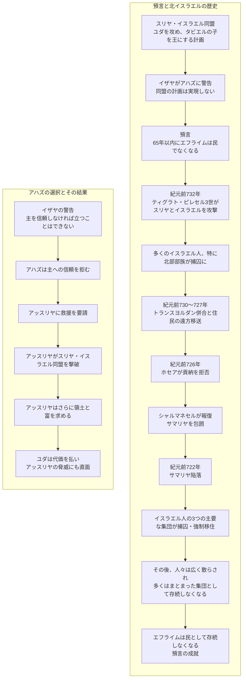

イザヤ書7章

７章の歴史的背景

紀元前734年頃、イザヤが預言をした当時、ユダ王国はスリヤ王レヂンとイスラエル王ペカの攻撃に晒されていました。両王は先代ヨタムの時代に同盟を結びエルサレムに侵攻したものの失敗していました（列王記下15:37, 16:5）。

紀元前735年にアハズが即位すると、両国はアッスリヤに対抗する地域統合のためエルサレム攻略を再開します。同盟参加を拒むアハズを倒し、アッスリヤに親交的ではない新王を立てる計画でした。

北から侵攻したペカの軍勢は、激戦の末にユダの兵士12万人を殺害し、1日で20万人を捕虜にしました（歴代誌下28:6-15）。捕虜は後に解放されたもののユダは滅亡の危機に瀕し、さらなる敵の進軍報告にアハズはエルサレムの命運を激しく恐れました（2節）。イザヤが慰めに訪れた際、アハズはキドロン渓谷で水源の点検を行っていたとみられます。

> **1. And it came to pass in the days of Ahaz the son of Jotham, the son of Uzziah, king of Judah, that Rezin the king of Syria, and Pekah the son of Remaliah, king of Israel, went up toward Jerusalem to war against it, but could not prevail against it.**  
> **1. ユダの王、ウジヤの子ヨタム、その子アハズの時、スリヤの王レヂンとレマリヤの子であるイスラエルの王ペカとが上ってきて、エルサレムを攻めたが勝つことができなかった。**

> **2. And it was told the house of David, saying, Syria is confederate with Ephraim. And his heart was moved, and the heart of his people, as the trees of the wood are moved with the wind.**  
> **2. 時に「スリヤがエフライムと同盟している」とダビデの家に告げる者があったので、王の心と民の心とは風に動かされる林の木のように動揺した。**

場所や人物のさまざまな名前をすべて適切に関連付けるために、同じ国であっても異なる名称で呼ばれることがあります。たとえば、報道機関がアメリカ合衆国や政府について、いくつかの異なる用語を用いることがありますが、古代の権力にもさまざまな名称が存在していました。この事変に関与した3つの国の名前は次のとおりです。

| 国 | 首都 | 領土または部族 | リーダー |
| :--- | :--- | :--- | :--- |
| ユダ | エルサレム | ユダ | ダビデの家の アハズ |
| スリヤ | ダマスコ | アラム | レヂン |
| イスラエル | サマリヤ | エフライム | レマリヤの息子ペカ |

> **3. Then said the Lord unto Isaiah, Go forth now to meet Ahaz, thou, and Shear-jashub thy son, at the end of the conduit of the upper pool in the highway of the fuller’s field;**  
> **3. その時、主はイザヤに言われた、「今、あなたとあなたの子シャル・ヤシュブと共に出て行って、布さらしの野へ行く大路に沿う上の池の水道の端でアハズに会い、**

第3節では、イザヤの2人の息子の1人が紹介されています。彼の名前はシャル・ヤシュブであり、これは「残りのものが戻る」ことを意味しています。この象徴的な名前は、イスラエルの残りのものが彼らの土地に文字通り戻ることを指していますし、悔い改めて主に帰依する人々の霊的な帰還をも意味しています。実際にはイザヤ書の後の章で見られるように、実質的な帰還は霊的な帰依によって起こる部分があるため、両方の意味が同時に当てはまります。

> **4. And say unto him, Take heed, and be quiet; fear not, neither be fainthearted for the two tails of these smoking firebrands, for the fierce anger of Rezin with Syria, and of the son of Remaliah.**  
> **4. 彼に言いなさい、『気をつけて、静かにし、恐れてはならない。レヂンとスリヤおよびレマリヤの子が激しく怒っても、これら二つの燃え残りのくすぶっている切り株のゆえに心を弱くしてはならない。**

イザヤと彼の息子がアハズに会うと、預言者は王にレヂンと「レマリヤの息子」（4節）について心配しないように伝えました。イザヤはペカについて話すときに見下した言葉遣いに躊躇することなく、名前も述べずに単に「レマリヤの息子」（5、9節）と呼び続け、軽蔑を表しました。

> **5. Because Syria, Ephraim, and the son of Remaliah, have taken evil counsel against thee, saying,**  
> **5. スリヤはエフライムおよびレマリヤの子と共にあなたにむかって悪い事を企てて言う、**

> **6. Let us go up against Judah, and vex it, and let us make a breach therein for us, and set a king in the midst of it, even the son of Tabeal:**  
> **6. 「われわれはユダに攻め上って、これを脅し、われわれのためにこれを破り取り、タビエルの子をそこの王にしよう」と。**

第6節で述べられているように、スリヤ・イスラエル同盟の目的はユダを分断し、王を置き換えることでした。

> **7. Thus saith the Lord God, It shall not stand, neither shall it come to pass.**  
> **7. 主なる神はこう言われる、この事は決して行われない、また起ることはない。**

> **8. For the head of Syria is Damascus, and the head of Damascus is Rezin; and within threescore and five years shall Ephraim be broken, that it be not a people.**  
> **8. スリヤのかしらはダマスコ、ダマスコのかしらはレヂンである。（六十五年のうちにエフライムは敗れて、国をなさないようになる。）**

> **9. And the head of Ephraim is Samaria, and the head of Samaria is Remaliah’s son. If ye will not believe, surely ye shall not be established.**  
> **9. エフライムのかしらはサマリヤ、サマリヤのかしらはレマリヤの子である。もしあなたがたが信じないならば、立つことはできない』」。**

詩的な預言の中で、主はイザヤを通して語り、ユダの恐れを和らげ、イスラエルがユダに押しつけようとした破壊と散乱の運命を、イスラエルの上に臨ませることを約束されました。神の啓示には、預言と歴史的事柄に関する次の5つの区分が交互に含まれています。

| 預言（または警告） | 節 | 歴史に関すること |
| :--- | :--- | :--- |
| 同盟の目的が果たされることは無い | 7 | |
| | 8a | スリヤの頭はダマスコとレヂン |
| 65年以内にエフライム（イスラエル）は散らされる | 8b | |
| | 9a | エフライムの頭はサマリヤとレマリヤの息子 |
| あなた（ユダのアハズ）が信じないなら、守りは無い | 9b | |

左側の列にある預言の3つの区分は、歴史に関する区分を考慮しなければ、一連の預言として読み取ることができます。このような歴史と預言の組み合わせは、イザヤの著作の特徴です。

この預言でイザヤは、スリヤ・イスラエル同盟の失敗と、イスラエル（エフライム）が65年以内に散らされることを約束しました。この預言は以下の段階を経て成就しました。

紀元前732年：アッスリヤ王ティグラト・ピレセル3世（プル）がスリヤとイスラエルを攻撃。特に北部の部族が多く捕囚となりました。

紀元前730〜727年：プルがトランスヨルダン地域を併合し、大量のイスラエル人を帝国遠方へ強制移住させました。

紀元前722年：イスラエル王ホセアの貢納拒否に対し、アッスリヤの新王シャルマネセルが攻撃を開始。サマリヤが包囲・陥落しました。

預言から十数年で同盟は崩壊し、3グループにわたる大規模な捕囚・移動が行われました。その後、彼らはアッスリヤから北方へ逃れて「失われた10部族」となり、約50年後には広く散らばって群れとしての形態を失いました。こうしてイザヤの預言は完全に現実となったのです。

預言の最後でイザヤは、ユダに対し「主を信頼しなければ立ち成り得ない」と警告しました。しかしアハズ王は信仰を欠き、イザヤが提示した信仰を促す「奇跡のしるし」さえ拒絶して、神ではなくアッスリヤに救いを求めました。

アッスリヤはスリヤとイスラエルを破壊して攻撃を阻止したものの、勢力拡大を止めることはなく、結局ユダも多大な代価（富と領土）を差し出すことになりました。

イザヤは真の脅威がアッスリヤであることを見抜いていました。ユダが主への信仰を堅持してさえいれば両方の脅威から守られていましたが、指導者アハズの信仰の欠如が国の暗雲となったのです。

> **10. Moreover the Lord spake again unto Ahaz, saying,**  
> **10. 主は再びアハズに告げて言われた、**

> **11. Ask thee a sign of the Lord thy God; ask it either in the depth, or in the height above.**  
> **11. 「あなたの神、主に一つのしるしを求めよ、陰府のように深い所に、あるいは天のように高い所に求めよ」。**

> **12. But Ahaz said, I will not ask, neither will I tempt the Lord.**  
> **12. しかしアハズは言った、「わたしはそれを求めて、主を試みることをいたしません」。**

> **13. And he said, Hear ye now, O house of David; Is it a small thing for you to weary men, but will ye weary my God also?**  
> **13. そこでイザヤは言った、「ダビデの家よ、聞け。あなたがたは人を煩わすことを小さい事とし、またわが神をも煩わそうとするのか。**

> **14. Therefore the Lord himself shall give you a sign; Behold, a virgin shall conceive, and bear a son, and shall call his name Immanuel.**  
> **14. それゆえ、主はみずから一つのしるしをあなたがたに与えられる。見よ、おとめがみごもって男の子を産む。その名はインマヌエルととなえられる。**

> **15. Butter and honey shall he eat, that he may know to refuse the evil, and choose the good.**  
> **15. その子が悪を捨て、善を選ぶことを知るころになって、凝乳と、蜂蜜とを食べる。**

> **16. For before the child shall know to refuse the evil, and choose the good, the land that thou abhorrest shall be forsaken of both her kings.**  
> **16. それはこの子が悪を捨て、善を選ぶことを知る前に、あなたが恐れているふたりの王の地は捨てられるからである。**

> **17. The Lord shall bring upon thee, and upon thy people, and upon thy father’s house, days that have not come, from the day that Ephraim departed from Judah; even the king of Assyria.**  
> **17. 主はエフライムがユダから分れた時からこのかた、臨んだことのないような日をあなたと、あなたの民と、あなたの父の家とに臨ませられる。それはアッスリヤの王である」。**

イザヤは自身の言葉の真実性を証明するため、神の名においてアハズ王にしるしを求めるよう命じました。これは救い主が責められたような不義な動機による要求（マタイ12:39）ではなく、預言者を通して提示された正当な機会でしたが、アハズは申し出を拒否しました（申命記6:16）。

アハズが拒んだ真の理由は、主を信頼せず裏でアッスリヤ王の援助に依存していたためです。しかし、この偽善的な不信仰は神の怒りを買い、アハズは望むしるしを選ぶ権利を失い、神が一方的に定められたしるしを受け入れるほかなくなりました。これは現代の啓示にある「しるしは信仰によって生じる。人の意志や望みではなく、神の意思による」（教義と聖約63:10）という原則そのものです。

不信仰は主を悲しませますが（13節）、主はあえてこの状況で幾重もの意味を持つ預言（しるし）を与えられました。そのメッセージの核心は、人は好むと好まざるとにかかわらず完全に神に依存している存在であり、いかに絶望的な状況であっても救い出す主の力に信仰を寄せるべきだという点にあります。同盟の陰謀が打ち砕かれるしるしとして与えられたのは、まさに「一人の男児の誕生」でした。

### インマヌエル預言

1. 預言の歴史的背景（アハズ王の時代）  
情勢：スリヤ（シリア）とエフライム（北イスラエル）の同盟軍が、南ユダ王国のエルサレムを北から攻撃しようと脅かしていた時期。  
目的：危機に直面したアハズ王とユダの人々に、「神が救ってくださる（＝神は我らと共に存す）」という確信と信仰を与えるために提示された即効性のある「しるし」。

2. 「インマヌエルの子」をめぐる3つの学説預言にある「生まれ来る子ども」と「若い女性（処女）」が誰を指すのかについては、主に3つの説があります。  
第1説：イザヤの息子説根拠：イザヤ書8章1〜4節の記述。イザヤの前妻が亡くなり再婚した妻（処女）から生まれた子（マヘル・シャラル・ハシ・バズ）が、インマヌエルとも呼ばれたという見解。  
第2説：当時の一般的な母親たち説（オットー・カイザー等）根拠：スリヤ・イスラエルの脅威が去った感謝から、当時出産した多くの女性たちが「神は共におられる（インマヌエル）」と我が子に名付けたという見解。  
第3説：特定の尊い女性の息子説根拠：ヘブライ語で「（その）若い女性/処女」と定冠詞がついているため、「ある不特定の女性」ではなく「ある特定の女性」とその息子を指しているという見解。  

3. 「5重の預言」
妊娠：その若い女性（処女）が妊娠する。  
誕生：男の子を産む。  
命名：「インマヌエル（神は私達と共におられる）」と名付けられる。  
脅威の消滅：その子が善悪の判断ができる年齢になる前に、同盟軍の脅威が消去し、平和（ミルクと蜂蜜）が戻る。  
次の警告：ただし、その後にアッスリヤによるさらなる試練が訪れる。  

4. 預言が成就する「3つのレベル（層）」この預言は、単一の時代だけでなく歴史の3つの場面で信仰を喚起する多重構造を持っています。  

| レベル | 時代 | 内容と成就の意味 |
| :--- | :--- | :--- |
| ① 歴史的成就 | アハズ王の時代 | 同盟軍の脅威からの解放と、神の保護の証明。 |
| ② 救い主の成就 | キリスト誕生の時代 | イエス・キリスト（メシヤ）の降誕。罪と霊的な束縛からの解放（マタイ1:21-23）。 |
| ③ 終末の成就 | 末日（現代〜将来） | 神は必ず民を救い出し「シオンを再びもたらす」という信仰の根幹。 |

> **18. And it shall come to pass in that day, that the Lord shall hiss for the fly that is in the uttermost part of the rivers of Egypt, and for the bee that is in the land of Assyria.**  
> **18. その日、主はエジプトの川々の源にいる、はえを招き、アッスリヤの地にいる蜂を呼ばれる。**

> **19. And they shall come, and shall rest all of them in the desolate valleys, and in the holes of the rocks, and upon all thorns, and upon all bushes.**  
> **19. 彼らはみな来て、険しい谷、岩の裂け目、すべてのいばら、すべての牧場の上にとどまる。**

> **20. In the same day shall the Lord shave with a razor that is hired, namely, by them beyond the river, by the king of Assyria, the head, and the hair of the feet: and it shall also consume the beard.**  
> **20. その日、主は大川の向こうから雇ったかみそり、すなわちアッスリヤの王をもって、頭と足の毛とをそり、また、ひげをも除き去られる。**

第20節で描かれる「かみそりで髪の毛を切り落とす」という表現は、人々に襲いかかる屈辱と奴隷状態を象徴しています。アッスリヤ人が捕虜の全髪の毛を剃り落とした理由は、主に以下の3点です。

1. 屈辱：尊厳を奪い、服従させるため。
2. 公衆衛生：過酷な移動環境における衛生面（害虫や病気）の維持。
3. 逃亡防止（識別）：脱走しても髪型ですぐ捕囚だと識別でき、他国民へ潜伏・逃亡するのを防ぐため。

> **21. And it shall come to pass in that day, that a man shall nourish a young cow, and two sheep;**  
> **21. その日、人は若い雌牛一頭と羊二頭を飼い、**

> **22. And it shall come to pass, for the abundance of milk that they shall give he shall eat butter: for butter and honey shall every one eat that is left in the land.**  
> **22. それから出る乳が多いので、凝乳を食べることができ、すべて国のうちに残された者は凝乳と、蜂蜜とを食べることができる。**

> **23. And it shall come to pass in that day, that every place shall be, where there were a thousand vines at a thousand silverlings, it shall even be for briers and thorns.**  
> **23. その日、銀一千シケルの価ある千株のぶどうの木のあった所も、ことごとくいばらと、おどろの生える所となり、**

第22-23節には、国の荒廃の深刻さが表現されてます。人々は家畜の群れの大部分を失うが（22節）、それでも人口が非常に少なくなるので限られた家畜が生き残った人々に豊富な牛乳と凝乳を提供できるようになります。

> **24. With arrows and with bows shall men come thither; because all the land shall become briers and thorns.**  
> **24. いばらと、おどろとが地にはびこるために、人々は弓と矢をもってそこへ行く。**

> **25. And on all hills that shall be digged with the mattock, there shall not come thither the fear of briers and thorns: but it shall be for the sending forth of oxen, and for the treading of lesser cattle.**  
> **25. くわをもって掘り耕したすべての山々にも、あなたは、いばらと、おどろとを恐れて、そこへ行くことができない。その地はただ牛を放ち、羊の踏むところとなる。**

これらの壊滅的な状況にも関わらず蜂蜜が豊富である理由は、耕作されずに残されたその地域の広大な土地に、すぐに野生の花や雑草、その他の花を咲かせる植物が茂り始めるからです。したがって、皮肉なことに、土地に残っている少数の人々は、比較的多数の食料生産動物のおかげで牛乳と蜂蜜を楽しめることになります。

しかしその一方で、雑草やとげのある茂み、そして野生の獣を撃退しなければならないため、依然として問題と危険が存在します。全体として、イザヤは人々を悩ます深刻な状況について説明しているのです。

インマヌエルの預言の数年後、イザヤは彼の以前の警告を新しい一連の預言で詳しく説明しています。今回は王や小集団への話ではなく、エルサレムの指導者たちが警告の証人となるよう、スリヤとイスラエルに対する差し迫ったアッスリヤの攻撃の約束を含んだ手紙にメッセージを書きました。その内容が次章(イザヤ8章)になります。
